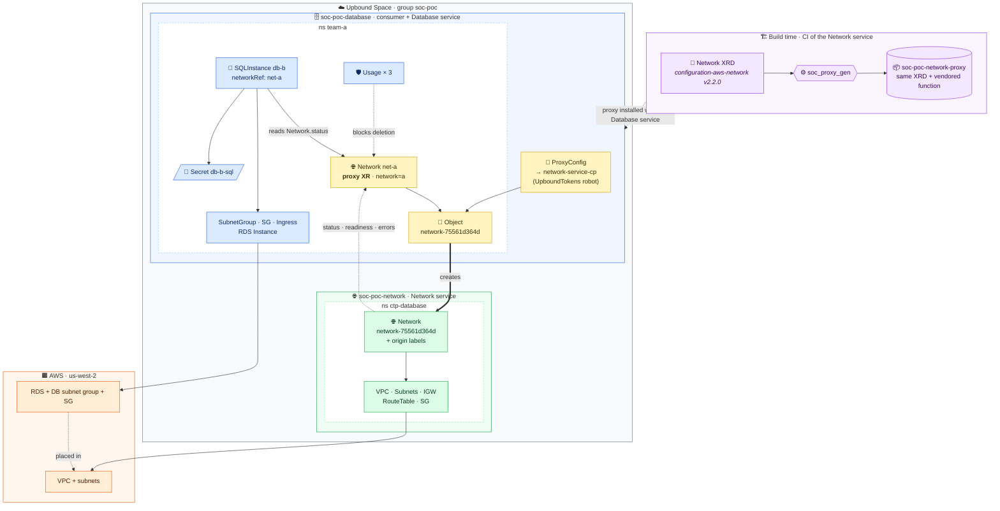
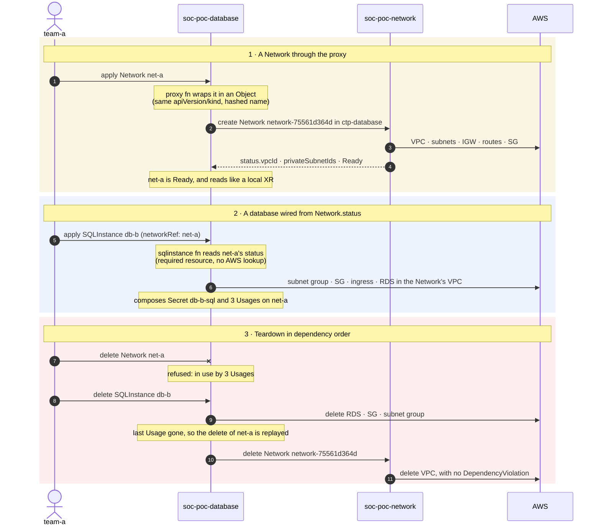

# soc-poc: Network and Database as separate service control planes

> [!IMPORTANT]
> **A proof of concept, not a supported product.** It explores a design and
> records what was learned in [FINDINGS.md](FINDINGS.md). APIs, package names and
> scripts may change or disappear without notice. Running it creates real control
> planes and AWS resources (a VPC and an RDS instance) in **your** accounts, which
> incur cost until you run `make teardown`.

A proof of concept for the **service-oriented control plane** (SOC) topology. It
splits two Crossplane services onto two Upbound control planes and checks that
the contract between them holds:

- **Network service.** The upstream
  [`configuration-aws-network:v2.2.0`](https://github.com/upbound/configuration-aws-network),
  unchanged.
- **Database service.** A SQLInstance service in Python. It needs a network, so
  it is a **consumer** of the Network service.



<sup>🟨 proxy · 🟦 Database service (consumer) · 🟩 Network service (provider) · 🟧 AWS · 🟪 build time</sup>

### Lifecycle, as the live run exercised it



## What is being proven

1. **A proxy is generated at build time from the service XRD alone.**
   - `soc_proxy_gen` copies the XRD byte for byte.
   - It vendors a generic Python function into the package, with constants derived from the XRD in `config.py`.
   - The resulting package depends only on provider-kubernetes and `proxy-base`.
   - It reads no per-service config, and there is no go-templating.
2. **A proxy XR acts like a local one.**
   - It creates the same XR on the service control plane, inside a provider-kubernetes `Object`.
   - The remote name is `network-<sha256(ns/name)[:10]>`, and the remote carries the local labels plus `soc.upbound.io/origin-*`.
   - It copies `status` back, surfaces `RemoteReady`/`RemoteSynced`, and follows the remote's readiness.
   - It mirrors every Secret the remote XR composes.
   - It forwards every `*SecretRef` whose local Secret exists.
3. **ProxyConfig only points at the target.**
   - A cluster-scoped `ProxyConfig`, named after the XRD, holds a provider-kubernetes ProviderConfig reference.
   - *PoC only:* it also holds `remoteNamespace`. In the full design that comes from the kubeconfig context instead, which needs a provider-kubernetes change.
4. **Standard resolution, and no AWS lookups.** The database selects a local `Network` by label or name through required resources, and reads `status.vpcId`, `status.privateSubnetIds` and `spec.parameters.vpcCidrBlock`. It never queries AWS.
5. **Deletion order comes from local `Usage`s.** A Network can't be deleted while anything in its VPC exists. The proxy Object keeps its finalizer until the remote is gone.
6. **The contract is typed at build time.** `database-service` depends on the generated `soc-poc-network-proxy` package at a pinned version.

The only runtime lookups are the proxy reading its `ProxyConfig` and the database reading its `Network`. Both are local and named.

## Layout

| Path | What |
|---|---|
| `soc-proxy/` | `proxy_function/` (the generic, vendored function: `proxy.py` is pure logic, `fn.py` adapts it to the SDK) and `soc_proxy_gen/` (the generator), plus unit tests |
| `proxy-base/` | Up project for the `ProxyConfig` XRD |
| `database-service/` | Up project for the SQLInstance service: Python function and composition tests |
| `_output/network-proxy/` | Generated by `make gen`; not committed |
| `examples/` | The demo's manifests |
| `hack/` | `setup.sh`, `verify.sh` (checks C1 to C9), `demo.sh` (narrated walkthrough), `teardown.sh` |
| `FINDINGS.md` | Results and go/no-go for each design element |

## Run it

You need `up` (logged in), `kubectl`, `yq`, `crossplane` and Docker. Host-side
Python runs in a `python:3.13` container, so nothing is installed locally.

**Before you start, you need:**
- **An Upbound organization** where you may create a control-plane group, a robot and a team.
- **An IAM role** in your AWS account that the AWS providers assume through Upbound's web identity (OIDC). Its trust policy must allow the providers on the two control planes. Its permissions must cover the VPC resources (VPC, subnets, internet gateway, route tables, security groups) and RDS (instances and DB subnet groups). See the Upbound documentation on authenticating AWS providers with Upbound OIDC.
- **Room in your account's quotas:** one VPC, and one RDS DB subnet group per database. The AWS default is 50 subnet groups per account.

```console
make unit lint gen check                    # local only: unit tests, lint, generate and check the proxy
make setup ORG=acme AWS_ROLE_ARN=arn:aws:iam::123456789012:role/upbound-soc-poc
make verify ORG=acme                        # contract checks C1-C9 on real AWS (~40 min, mostly RDS)
make demo ORG=acme                          # narrated walkthrough in six phases (DEMO_AUTO=1 for no pauses)
make teardown ORG=acme                      # delete the AWS resources; DELETE_CONTROL_PLANES=1 also removes the CPs
```

`make setup` installs the published, public packages
`xpkg.upbound.io/solutions/soc-poc-*:v0.1.0`, so there's nothing to build first.
`make push` is for maintainers republishing those packages.

**Required settings:**

| Setting | What it is |
|---|---|
| `ORG` | Your Upbound organization |
| `AWS_ROLE_ARN` | The role described above (setup only) |

**Optional settings:**

| Setting | Default |
|---|---|
| `SPACE` | `upbound-gcp-us-central-1` |
| `GROUP` | `soc-poc` |
| `VERSION` | `v0.1.0` |
| `REGISTRY` | `xpkg.upbound.io/solutions` |
| `DBS` | `db-a db-b`, the example databases `verify` creates; each needs a subnet group |
| `PULL_TOKEN_FILE` | unset. A robot token JSON, needed only if you pull the packages from a private registry |

Kubeconfigs and tokens are written to `_output/live/` (gitignored) and nowhere else.
